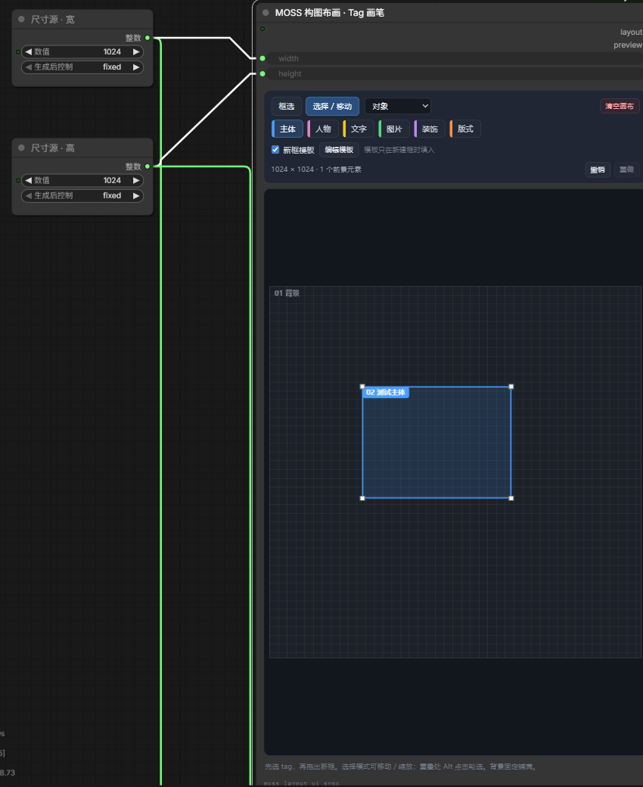

# ComfyUI MOSS Layout UI

给 [MOSS-Image](https://github.com/OpenMOSS/MOSS-Image) 用的三节点可视化排版插件：**在画布上拖框 → 编辑元素提示词 → 一键编译成模型能吃的 `summary/items` 紧凑 JSON**。不用手写坐标，换画布尺寸也不用重排。



> 纯前端 DOM 面板 + 一层薄的 Python 编译层。不联网、不装额外依赖（只用 ComfyUI 自带的 torch / numpy / Pillow）。

---

## 三个节点

| 节点 | 显示名 | 输入 | 输出 |
| --- | --- | --- | --- |
| `MOSSLayoutCanvas` | MOSS 构图布画 · Tag 画笔 | `width` INT、`height` INT、`state`（隐藏） | `layout` STRING、`preview` IMAGE |
| `MOSSLayoutElements` | MOSS 元素管理 · 定位 / 提示词 | `layout` STRING、`state`（隐藏） | `elements` STRING、`character_boxes` STRING |
| `MOSSLayoutStandardPrompt` | MOSS 标准提示词 · 导入 / 整理 / 导出 | `layout` / `elements` / `character_boxes` STRING、`state`（隐藏） | `prompt` STRING、`standard_prompt` STRING |

同一套三个节点按实际连线共享 `moss-layout/v1` 布局，每个画布独立保存，多套排版可以放在同一工作流中（百分比坐标，背景永远在 `elements[0]`、固定 `[0,0,100,100]` 且不参与生成 items）。
`state` 是隐藏 widget，用来把布局随工作流一起保存；运行时后端也会读它做兜底。

`character_boxes` 输出的是**最终 items 里人物项的序号**（1 起、逗号分隔，例如 `1, 3`；没有人物时为空字符串），与 `MOSSImageLayoutPrompt.character_boxes` 的写法一致。标准提示词节点读到这个列表时，会把对应序号的非文字项按人物编译；不符合该写法的文本（包括 1.2.0 及更早的 JSON 数组）会被忽略，不影响元素自身的类型。

---

## 安装

```bash
cd ComfyUI/custom_nodes
git clone https://github.com/MIKOU306/ComfyUI-MOSS-Layout-UI.git comfyui-moss-layout-ui
```

或直接下载 zip 解压到 `ComfyUI/custom_nodes/comfyui-moss-layout-ui/`。同一实例只保留一份插件：如果已有旧版手动安装的 `moss-layout-ui`，请先将它移出 `custom_nodes`，避免与 Registry 安装版重复加载。然后：

1. 重启 ComfyUI
2. 浏览器 **Ctrl+F5** 重载前端
3. 画布上搜索 `MOSS`，添加三个节点，或导入 `examples/MOSS-layout-poster-INT8.json`

**要求**：ComfyUI 提供新版节点 API（`comfy_api.latest`）。开发与验证环境 = ComfyUI 0.41.0 / 前端 1.55.18 / Python 3.12。

### 1.3.1 直接导入官方布局提示词

- 粘贴官方指南里那种模型用的布局提示词（`abs_centralized` + `yxyx`）就能导入：它不带宽高，按当前画布尺寸反算百分比，`summary` 与元素的 `tags / palette`、文字内容一并还原。注意它若原本是为别的画布尺寸生成的，坐标会被重新解释。

### 1.3.0 官方可选字段与坐标精度

- 补齐官方可选字段：`summary.meta` / `summary.canvas` / `summary.palette` 与元素 `tags` / `palette`，全部直接编译进模型提示词（不填就不下发）。
- 支持导入官方 `width/height + abs/xyxy` 草稿，新增「导出官方草稿」。
- 坐标精度 0.1% → 0.01%，编译时吸附整像素：bbox 与官方参考编译器逐值一致，此前有 0–1px 偏差。
- 画布提示 tag 与模型 label 的关系：只有人物、文字单独成类，其余按物体下发，额外语义写进 tags。

### 1.2.1 连线端口、撤销与人物序号

- **连线后端口不再消失**：`layout` / `elements` / `character_boxes` 三个输入改为 22px 窄行，行内显示「已连线 / 未连线」，左侧连接点可以正常看到、连线与断开；`state` 仍完全隐藏。经典节点与 Nodes 2.0 使用同一套行渲染。
- **布局修改进入 ComfyUI 的撤销与未保存提示**：只改布局也会提示未保存，撤销可回到编辑前；一次连续输入或长按方向键算一步，载入工作流不产生撤销步。
- **应用模板 / 导入布局可撤销**：不再清空画布撤销历史；模板改动生成尺寸时会明确提示新的宽高。
- 元素管理节点的 `character_boxes` 改为输出最终 items 中人物项的序号（`1, 3` 这种写法），不再输出 JSON 对象数组；接到 `MOSSImageLayoutPrompt.character_boxes` 不会再被解析成无意义的编号。
- 标准提示词节点会读取 `character_boxes`：传入 `1, 3` 时把对应序号的非文字项按人物编译；其他写法直接忽略。前端「最终生成词」预览使用同一规则。
- 只把真正的布局输出当作布局输入，误接其他输出时按未连接处理。
- 元素面板按帧合并重绘，元素集合不变时只更新行内容；清理定位闪烁定时器；复制元素写入数字坐标。
- 画布：方向键连按合并为一步撤销、指针移动不再重复测量画布尺寸、新建框最小尺寸与缩放下限一致。
- DOM 面板不参与序列化，`widgets_values` 不再多存空值；后端预览字体补充 macOS / Linux 候选路径；三个节点增加英文搜索别名。

### 1.2.0 模板库与文字排版助手

- 标准提示词节点新增「布局模板库」：电影海报、电商促销、杂志封面、人物介绍卡；可保存、更新、删除自定义模板，导入 / 导出可分享的 JSON 文件。
- 元素管理节点的文字元素新增字体风格、颜色、参考字号、行距与对齐；画布和详情面板显示文案预览，支持手动换行、按框宽分行与撤回分行。
- 新增空文字、容量、断线、跨画布接线、潜空间尺寸不一致及重复安装提示。
- 修复边缘零尺寸、异常数字导致后端失败、背景排序与合并、空元素列表未清空以及分组重排后选择不完整。

自定义模板保存在**当前浏览器、当前 ComfyUI 地址**，换电脑或换地址请先导出。应用模板后，已连接的宽高输入仍优先。样式转成模型 caption 描述，预览与容量估算不保证最终生成效果。

这是本地 1.2.0 测试版。使用方法见 [模板与文字助手](docs/templates-text.md)，审查与验证范围见 [审查报告](docs/audit-1.2.0.md)。更新后请重启 ComfyUI，再按 Ctrl+F5。

### 1.1.0 画布编辑增强

新增多选、编组、位置锁定、吸附参考线、六种对齐、水平与垂直等距分布、方向键微调。选中多个元素后，可以一起移动和缩放；分组与锁定随工作流保存。现有布局仍可直接导入，模型接线无需改变。

使用方法见 [画布编辑说明](docs/canvas-editing.md)，测试范围见 [验证记录](docs/validation-1.1.0.md)。这是本地测试版，更新后请**重启 ComfyUI，再按 Ctrl+F5**。

### 1.0.1 更新

修复多套节点串数据、背景描述未进入提示词、多行文字丢换行，以及清空画布误删描述。更新后请**重启 ComfyUI，再按 Ctrl+F5**；无需重建工作流或重新下载模型。
31 项浏览器检查与 3 次后端提示词编译通过，具体范围见 [验证记录](docs/validation-1.0.1.md)。

---

## 使用

**① 构图布画**：先选 tag（主体 / 人物 / 文字 / 图片 / 装饰 / 版式），在空白处拖出新框；框内拖动 = 移动，四角手柄 = 缩放；重叠处 `Alt + 点击` 轮选；支持撤销 / 重做（60 步）、新框模板提示词、清空画布。
画布宽高可接 `PrimitiveInt` 联动（支持 `PrimitiveInt`、前端 `PrimitiveNode`、`Reroute`），元素保留百分比位置，改尺寸不用重排。
「清空画布」只删除未锁定的前景，保留已锁定元素、全局描述、背景和尺寸，可撤销与重做。

按住 **Shift 点击**增减选择；在「选择 / 移动」模式下拖空白处框选（框选模式下按住 Shift 也可框选）。**Ctrl+G** 编组、**Ctrl+Shift+G** 解组；方向键微移 `0.1%`，Shift+方向键移 `1%`。打开「吸附」可显示参考线，按住 Ctrl 临时跳过。画布内的小步编辑用面板的撤销 / 重做按钮；布局修改同时会记入 ComfyUI 的全局撤销，所以只用全局撤销也能回到编辑前的布局，并且只改布局时关闭标签页会提示未保存。

**② 元素管理**：搜索（编号 / 名称 / tag / 提示词）、按 tag 筛选、改名称 / tag / 生成类型 / 提示词 / 左上宽高四个百分比；上移、下移、复制、删除。
生成类型选「文字」时请填写**文字内容**；空文字框会显示提示并从生成词中跳过，布局仍保留该框。文字内容支持多行，编辑、保存与最终提示词会保留换行。

**③ 标准提示词**：写全局提示词（整张图的场景 / 风格 / 光 / 阅读顺序）；下方一行填写**画面类型**（单图 / 多格 / 拼贴）、**meta**（媒介 / 体裁标签）与**调色板**，多个值用逗号分隔，这三项写入 `summary` 并直接进模型输入。粘贴标准 JSON 后点「导入新布局」或「合并并保留修改」；「导出回输入框」把当前布局导出成可编辑 JSON，「导出官方草稿」则输出官方工具链能直接吃的 `width/height + abs/xyxy` 草稿；底部两个 tab 在「当前标准 JSON / 最终生成词」之间切换，可一键复制。

**连线**：`画布.layout → 元素.layout` 与 `标准提示词.layout`；`元素.elements / character_boxes → 标准提示词同名输入`；`标准提示词.prompt → CLIPTextEncode.text`。

---

## 输出格式

`prompt` 输出的是 MOSS-Image 官方布局格式，直接接正向 `CLIPTextEncode.text`：

```json
{
  "summary": {"caption": "整张海报的场景、风格与阅读顺序", "meta": ["poster"], "canvas": "single"},
  "items": [
    {"label": "text",      "caption": "字体与承载面描述", "text": "黑暗骑手", "bbox": [358, -320, 493, 320]},
    {"label": "character", "caption": "人物外观描述",                 "bbox": [-447, -266, 293, 266]},
    {"label": "object",    "caption": "物体外观描述", "tags": ["product"], "bbox": [-17, -330, 346, 331]}
  ],
  "bbox_coord_space": "abs_centralized",
  "bbox_format": "yxyx"
}
```

- `bbox` = `[y_min, x_min, y_max, x_max]`，整数，**以画布中心为原点**；1024² 画布范围 −512…+512。
- `label` 只有 `object` / `character` / `text`；`text` 项必须带 `text`。界面的 tag（主体 / 人物 / 文字 / 图片 / 装饰 / 版式）只是编辑器分类：人物 → `character`，文字 → `text`，其余都按 `object` 下发，额外语义写进元素的 `tags`。
- 可选字段（官方定义，不填就不下发）：`summary.meta`、`summary.canvas`（`single` / `multi_panel` / `collage`）、`summary.palette`，元素级 `tags` 与 `palette`。
- `standard_prompt` 输出的是带缩进的 `moss-layout/v1` 完整布局，方便查看 / 复制 / 版本管理。
- 全局描述与背景元素描述共同编入 `summary.caption`，完全相同的两段只保留一次；没有前景时输出合并后的自然语言提示词。
- 布局内部用百分比 `[左%, 上%, 宽%, 高%]`（两位小数），所以换尺寸不用改数据；编译时像素边会吸附到整像素，与官方参考编译器结果逐值一致。但**生成尺寸必须等于画布尺寸**，否则坐标语义就错了。

---

## 排版建议

框表达位置和占用区域，caption 描述外观与风格，text 保存准确文案。多个独立主体通常应分成不同元素；整体描述与元素描述尽量保持一致。

文字过长时可手动换行、减小参考字号或扩大文字框。容量检查是排版估算，没有通用的「人物必须占宽 65%」或「文字必须距边缘 60 像素」硬限制。

模型的布局功能与手动换行格式见 [MOSS 官方用户指南](https://github.com/OpenMOSS/MOSS-Image/blob/main/USERGUIDE_ZH.md#layout-prompt实验性功能)。插件的字体设置会转成 caption 中的文字描述，不会向模型添加自定义字体参数。

---

## 已知限制

- **只支持轴对齐矩形**。MOSS-Image 的 `bbox` 规范就是四个整数，模型没有 mask 通道；扩多边形 / 圆形只能在 UI 层做，编译时仍得退化成外接矩形（想收紧选区可以用更小的矩形近似）。
- 节点按上游实际连线归属画布；没有连接到画布的编辑节点会独立保存。需要联动时请按上面的连线方式连接。
- 背景元素固定铺满，不参与 `items`；背景描述会合入整张图的 `summary.caption`。

---

## English quickstart

Three nodes for MOSS-Image layout posters: draw boxes on a canvas, describe each element, and get the official `summary/items` JSON that MOSS consumes (`abs_centralized` / `yxyx`).

1. Copy this folder into `ComfyUI/custom_nodes/comfyui-moss-layout-ui`. Remove older duplicate copies from `custom_nodes` before restarting.
2. Restart ComfyUI and hard-reload the frontend (**Ctrl+F5**).
3. Import `examples/MOSS-layout-poster-INT8.json`, or add the three `MOSS ...` nodes from the node menu.
4. Wire `标准提示词 (StandardPrompt).prompt` into the positive `CLIPTextEncode.text`, and set the empty latent size to the same canvas size.

Layout is stored in percent coordinates, so changing the canvas size never requires re-laying-out boxes. Requires a ComfyUI build with the new node API (`comfy_api.latest`).

Version 1.0.1 isolates separate canvas chains, includes background descriptions in the compiled caption, preserves multiline text, and keeps background/global descriptions when clearing foreground boxes. Restart ComfyUI and hard-reload the browser after updating. See [validation](docs/validation-1.0.1.md) for the tested scope.

Version 1.1.0 adds Shift multi-selection, marquee selection, grouping (Ctrl+G / Ctrl+Shift+G), position locks, optional snapping, alignment, distribution and arrow-key nudging. Groups and locks persist in workflows and are excluded from the compiled model prompt. Use the canvas undo/redo buttons for canvas edits. See [editing controls](docs/canvas-editing.md) and [validation](docs/validation-1.1.0.md). This version is a local preview.

Version 1.2.0 adds four built-in layouts, browser-local custom templates with JSON import/export, text previews, typography descriptions, wrapping and capacity checks. Workflow diagnostics highlight disconnected/mixed canvases, dimension mismatches and duplicate installations. Empty text boxes remain editable but are skipped in the model prompt. Typography is stored as optional editor metadata and compiled into ordinary captions. See [usage](docs/templates-text.md) and [audit](docs/audit-1.2.0.md).

---

## License

MIT. MOSS-Image itself is Apache-2.0 by OpenMOSS; this repo only contains the three layout nodes and does not ship any model weights.
