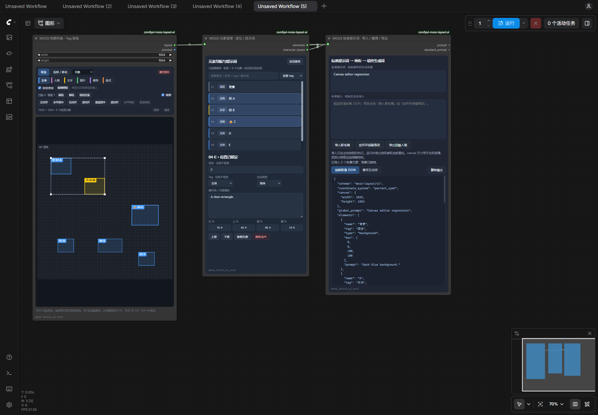

# 画布编辑

适用于 1.1.0 本地测试版。三个节点和原有连线保持兼容。

| 操作 | 用法 |
| --- | --- |
| 多选 | Shift 点击画布元素或元素列表，增减选择 |
| 框选 | 「选择 / 移动」模式下拖动空白处；按住 Shift 可追加框选，在框选模式下也可使用 |
| 移动 / 缩放 | 拖选中元素一起移动；拖共同选区四角按比例分配各元素的新位置和大小 |
| 编组 / 解组 | 按钮或 Ctrl+G / Ctrl+Shift+G；点击任意成员选中整个组；仅支持一层分组 |
| 位置锁定 | 点击「锁定位置」，再次点击解锁；锁定项不参与移动、缩放、微调、删除、清空、对齐或分布 |
| 吸附 | 勾选「吸附」；靠近画布边缘、中心或其他元素边缘、中心时显示青色参考线并吸附；Ctrl 临时跳过 |
| 对齐 | 左、中、右、顶、中、底六种；多个可编辑单元按其共同边界对齐，一个单元按画布对齐 |
| 等距 | 至少三个可编辑单元；保持两端，以相等间隔分布，空间不足时允许重叠 |
| 微调 | 画布获得焦点后按方向键移动 0.1%，Shift+方向键移动 1%，以画布百分比为单位 |
| 全选 / 删除 | 画布内 Ctrl+A 全选前景；Delete / Backspace 删除未锁定项；Escape 取消拖动并清除选择 |
| 撤销 / 重做 | 使用画布面板按钮，最多 60 步；ComfyUI 全局撤销快捷键仍由 ComfyUI 处理 |

分组作为一个整体参与移动、缩放、对齐与分布；任一成员锁定时，整个组的位置都受保护。锁定只保护编辑器中的几何位置，文字与提示词仍可编辑，也不代表模型会精确遵循每个框。

画布快捷键仅在画布面板内生效，输入框仍使用普通文字编辑快捷键。元素管理面板和导入面板的外部更新会重置画布的本地撤销记录；保存、重新打开工作流也不会保留这 60 步历史。

分组和锁定写入 `moss-layout/v1` 元素的可选属性 `group_id` / `locked`，吸附开关写入画布节点属性。旧布局默认不分组、不锁定。标准 JSON 导出保留这些属性，最终给 MOSS 的 `summary/items` 提示词只包含模型字段。

更新时先将旧版节点目录移出 `custom_nodes`，只保留一个 `comfyui-moss-layout-ui` 目录，再重启 ComfyUI、按 Ctrl+F5。
